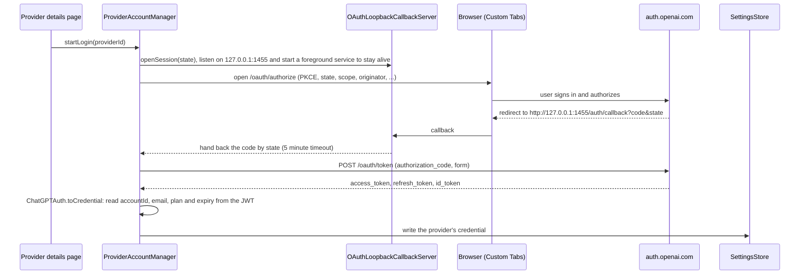

# ai module

## Provider authentication

Providers fall into two groups, depending on where their credentials come from:

- **API key providers**: subclasses of `ProviderSetting.ApiKey`, i.e. `OpenAI` / `Google` / `Claude`. The user enters the
  credentials (API key, Vertex service account) and the request address `baseUrl`, which may point to the official API or
  any compatible relay.
- **Account providers**: subclasses of `ProviderSetting.Account`, currently `ProviderSetting.ChatGPT` and `ProviderSetting.Grok`.
  Credentials can only be obtained by signing in to an account (OAuth), and the request address is hard-coded.

The ai module only puts credentials into requests. Sign-in, refresh and persistence of account credentials live in the app
layer and are injected through `AccountCredentialProvider`; the ai module never touches the settings store and never starts an
authorization flow.

### Concepts

| Concept                     | Location                                   | Description |
|-----------------------------|--------------------------------------------|-------------|
| `ProviderSetting`           | `provider/ProviderSetting.kt`              | The full configuration of one provider, persisted with the settings. Types are split by **protocol**; different vendors of the same protocol (official, various relays) are different instances of the same type |
| `ProviderSetting.ApiKey`    | same                                       | Common parent of API key providers; holds `apiKey`, `baseUrl` and `quotaQuery` |
| `ProviderSetting.Account`   | same                                       | Common parent of account providers; holds `credential: OAuthCredential?` (`null` means signed out), which can only be replaced via `withCredential` |
| `OAuthCredential`           | same                                       | The credential obtained by signing in, see the table below. `toString()` masks the tokens |
| `AccountCredentialProvider` | `provider/AccountCredentialProvider.kt`    | Implemented by the app layer and injected through the `ProviderManager` constructor. A provider asks it for a usable credential before every request |
| `KeyRoulette`               | `util/KeyRoulette.kt`                      | Rotates between multiple keys for API key providers |
| `customHeaders`             | `ProviderSetting` / `TextGenerationParams` | User-defined request headers. Request-level headers come from the assistant and the model and override provider-level headers with the same name |
| `Model.providerOverwrite`   | `provider/Model.kt`                        | Lets a single model use another provider configuration. It is an **independent copy** with its own credentials and does not follow its parent provider |
| `ProviderQuota`             | `provider/ProviderQuota.kt`                | Return value of `Provider.getQuota`, typed by meaning: `Balance` (account balance) and `UsageLimits` (subscription usage windows) |
| `QuotaQuery`                | same                                       | Custom quota query for API key providers: URL, headers (may reference `{{baseUrl}}` and `{{apiKey}}`) and a value expression |

Fields of `OAuthCredential`:

| Field          | Description |
|----------------|-------------|
| `accessToken`  | The token sent in `Authorization: Bearer` |
| `refreshToken` | Used to obtain a new access token. Treated as single-use (ChatGPT rotates it on every refresh); if the refresh response does not include a new one, the old one is kept |
| `expiresAt`    | Expiry time of the access token (millisecond timestamp). `0` means unknown, in which case it is not refreshed proactively |
| `accountId`    | Vendor-side account or workspace ID. ChatGPT requests must include it; for Grok it is the token `sub` and is only used to tell accounts apart |
| `email`, `plan`| Only used for display |

### API key providers

| Type                                   | Authentication |
|----------------------------------------|----------------|
| OpenAI (Chat Completions, Responses)   | `Authorization: Bearer <key>` |
| Claude                                 | `x-api-key: <key>` |
| Google (Gemini API)                    | `x-goog-api-key: <key>` |
| Google (Vertex, API key)               | query parameter `key=<key>` |
| Google (Vertex, service account)       | `Authorization: Bearer <access token>`, obtained by `ServiceAccountTokenProvider` |

- **Key rotation**: `apiKey` may contain several keys separated by whitespace, newlines or commas. `KeyRoulette.lru` prefers a key
  that has never been used, otherwise the least recently used one. Usage records are kept per provider id in
  `cacheDir/lru_key_roulette.json` and expire after one day. Service accounts do not take part in rotation.
- **Vertex service account**: a JWT is signed with the service account private key and exchanged at `oauth2.googleapis.com` via
  `urn:ietf:params:oauth:grant-type:jwt-bearer` for an access token valid for one hour. It is cached in memory per
  "account + scope" and fetched again 5 minutes before expiry. It is never written to disk.
- **Header order**: custom headers first, then the authentication header.
- **Quota query**: configured by the user through `QuotaQuery`; the authentication header is also written in its `headers`
  (defaults depend on the type). `{{apiKey}}` picks one of the keys, just like chat requests. It sends the key to an address the
  user entered, which is the same trust level as a user-entered `baseUrl`. Only `baseUrl` and `apiKey` are exposed as variables;
  fields such as the service account private key cannot be referenced.

### Account providers

#### Design principles

1. **The address is decided by the type.** Account providers have no `baseUrl` or `apiKey` field, so a provider only sends the
   token to hard-coded addresses. Users can only change the name, enabled state, models and custom headers; the authentication
   header is written with `header()` after the custom headers, so a custom header cannot replace it. The same goes for quota
   queries: account providers have no `QuotaQuery`, and the query address is hard-coded in the provider.
   Therefore configuration can never send the token to a third-party address. This is why a separate subclass is used instead
   of adding a credential field to `ProviderSetting.OpenAI`.
2. **Only the app layer's `ProviderAccountManager` writes credentials.** Editing in the UI, importing and sharing can neither
   change nor leak credentials; see [Where credentials are written and where they go](#where-credentials-are-written-and-where-they-go).
3. **Refreshes are serialized per provider.** A refresh token can only be used once; if two requests refresh at the same time,
   one of them fails with an already invalidated refresh token. So refreshing happens under a per-provider lock, and after
   taking the lock the latest credential is re-read from the settings before deciding whether to refresh.

#### Sign-in

Using ChatGPT as the example, the protocol parameters match the Codex CLI (`client_id` and the callback address are registered by
the Codex CLI on the OpenAI authorization server and must be used as is):



Grok signs in with a device code (RFC 8628). The protocol parameters match the Grok CLI, and no local callback is needed:

```mermaid
sequenceDiagram
    participant UI as Provider details page
    participant M as ProviderAccountManager
    participant B as Browser (Custom Tabs)
    participant A as auth.x.ai

    UI->>M: startLogin(providerId)
    M->>A: POST /oauth2/device/code (client_id, scope)
    A-->>M: device_code, user_code, verification_uri(_complete)
    M->>UI: state DeviceCode(userCode, url); the UI shows the code
    M->>B: open verification_uri_complete (code already included)
    loop poll every interval, add 5 s on slow_down
        M->>A: POST /oauth2/token (device_code)
        A-->>M: authorization_pending / access_token
    end
    M->>M: GrokAuth.toCredential: accountId from sub, email from id_token, otherwise from userinfo
    M->>M: write the credential, same as ChatGPT
```

- The sign-in state is exposed to the UI through `ProviderAccountManager.loginStatus`: `Authorizing` while in progress,
  `DeviceCode(userCode, verificationUrl)` while a device-code sign-in waits for confirmation, `Failed(message)` on failure;
  it is removed after success or cancellation.
- Only the JWT payload is decoded and the signature is not verified: the token comes straight from the authorization
  server's HTTPS response.
- Authorization and refresh requests use the app's `OkHttpClient`, so the proxy from the settings applies.

#### Requests and refresh

```mermaid
sequenceDiagram
    participant P as ChatGPTProvider
    participant M as ProviderAccountManager
    participant DS as SettingsStore
    participant A as auth.openai.com
    participant C as chatgpt.com/backend-api/codex

    P->>M: getCredential(setting, rejectedAccessToken = null)
    M->>M: take the provider's lock and re-read the latest credential from the settings
    alt less than 5 minutes before expiry
        M->>A: POST /oauth/token (refresh_token, JSON)
        A-->>M: new access_token (possibly with a new refresh_token and id_token)
        M->>DS: write the credential back
    end
    M-->>P: credential
    P->>C: request (Authorization, ChatGPT-Account-ID, originator)
    opt 401 returned
        P->>M: getCredential(setting, rejectedAccessToken = the token just used)
        Note over M: force a refresh if the settings still hold this token;<br/>if a concurrent request already refreshed it, return the new one
        M-->>P: new credential
        P->>C: resend once with the new token
    end
```

- The 401 retry is done by an OkHttp `Authenticator` (`AccountTokenAuthenticator` in `providers/AccountAuth.kt`) and covers
  streaming, non-streaming, model list and quota requests. `configureAccountAuth` writes `Authorization: Bearer`; each provider
  only adds its own extra authentication headers, and the retry rewrites the same set of headers with the new credential.
  It recognizes account requests by a tag on the request, and each request is retried at most once.
- When a refresh fails (network error, invalid refresh token, ...), a "please sign in again" error is thrown, but the
  **credential is not cleared**: a temporary network problem should not sign the user out. Signing in again simply overwrites
  the old credential.
- When signed out, `getCredential` throws immediately.

#### Where credentials are written and where they go

| Scenario | Handling |
|----------|----------|
| Sign-in, refresh, sign-out | `ProviderAccountManager` replaces only that provider's `credential` via `SettingsStore.update` |
| Saving a provider on the settings page | `preserveCredential` keeps the latest credential from the settings. The token may have been refreshed in the background during editing; writing the whole object back would overwrite the rotated refresh token with a stale one |
| Share / QR code import | Credentials are stripped on both encode and decode; account providers have no share button |
| Model-level provider override | Not offered for account providers, otherwise the credential would be copied into a copy that never refreshes |
| Switching provider type on the settings page (model-level override only) | Converting from an account type to an API key type drops the credential and uses the target type's default address |
| Backup, WebDAV/S3 sync | Saved with the settings, like API keys. After restoring on another device both share the same refresh token; a refresh on either side invalidates the other, which must sign in again |
| Web event stream | Included in the full pushed settings, like API keys |

#### ChatGPT request conventions

The address is fixed to `https://chatgpt.com/backend-api/codex`. The protocol is the Responses API, with a few differences from
`api.openai.com`; see `ChatGPTProvider`. Request body differences are expressed with `CODEX_CAPABILITIES`
(`ResponseProviderCapabilities`) and generated directly by `ResponseAPI`:

- Authentication headers: `Authorization: Bearer <accessToken>`, `ChatGPT-Account-ID: <accountId>`, `originator: codex_cli_rs`;
- `POST /responses` only supports streaming and `store` must be false; the system prompt is sent as a `developer` message at
  the start of `input` instead of `instructions`; `max_output_tokens`, `temperature` and `top_p` are not accepted;
  `reasoning.encrypted_content` is always requested and the conversation ID is used as `prompt_cache_key`;
- `GET /models?client_version=<version>` returns the models available to Codex, filtered by client version;
- Subscription usage uses `GET https://chatgpt.com/backend-api/wham/usage` (not under `/codex`), reading `primary_window` and
  `secondary_window` of `rate_limit` (usually 5 hours and one week) and returning `ProviderQuota.UsageLimits`;
- Streaming responses have no `Content-Type`, so they rely on the SSE implementation in the common module that relaxes this
  check (`me.rerere.common.http.sse.newEventSource`).

#### Grok request conventions

SuperGrok subscription, modeled on the xai-oauth of can1357/oh-my-pi; see `GrokProvider`:

- Chat goes to `https://api.x.ai/v1/responses` with only `Authorization: Bearer <accessToken>`; `x-grok-conv-id: <sessionId>`
  is sent to hit the prompt cache;
- Request body (`GROK_CAPABILITIES`): the system prompt is a `system` message at the start of `input`; `reasoning.summary` is
  not sent; `reasoning.effort` only has low/medium/high and is only sent to models whose catalog entry declares reasoning
  levels; `reasoning.encrypted_content` is always requested, which keeps multi-turn reasoning connected when `store=false`;
- The model catalog merges `https://cli-chat-proxy.grok.com/v1/models-v2` (Grok CLI) and `https://api.x.ai/v1/models`; when both
  have a model, the former wins. Image, voice and other non-chat models are filtered out;
- Quota uses `https://cli-chat-proxy.grok.com/v1/billing`: first the weekly credits with `?format=credits`, then, for unified
  billing accounts, the monthly quota without parameters;
- Requests to `cli-chat-proxy.grok.com` also carry `X-XAI-Token-Auth: xai-grok-cli`, matching the official CLI.

### Code map

| Module | File | Responsibility |
|--------|------|----------------|
| ai     | `provider/ProviderSetting.kt` | `OAuthCredential`, `ApiKey`, `Account`, `ChatGPT`, `Grok`, `supportsBuiltInSearch` |
| ai     | `provider/AccountCredentialProvider.kt` | Credential interface |
| ai     | `provider/ProviderQuota.kt`, `provider/QuotaQueryRunner.kt` | Quota types, custom query configuration and execution |
| ai     | `provider/ProviderManager.kt` | Injects `AccountCredentialProvider` and dispatches providers by type |
| ai     | `provider/providers/AccountAuth.kt` | Authentication headers and 401 retry for account requests |
| ai     | `provider/providers/chatgpt/ChatGPTProvider.kt` | Codex backend adapter, subscription usage |
| ai     | `provider/providers/grok/GrokProvider.kt` | xAI Responses adapter, model catalog merge, SuperGrok quota |
| ai     | `util/KeyRoulette.kt` | Key rotation |
| ai     | `provider/providers/google/vertex/ServiceAccountTokenProvider.kt` | Vertex service account token exchange |
| oauth  | `OAuthHttpClient.kt` | PKCE, authorization URL, code-for-token exchange, device-code authorization and polling, refresh (form or JSON). Also used by MCP OAuth |
| oauth  | `OAuthLoopbackCallbackServer.kt`, `OAuthCallbackForegroundService.kt` | Local callback server that dispatches callbacks by state; a foreground service keeps it alive while waiting |
| app    | `data/ai/account/ChatGPTAuth.kt`, `GrokAuth.kt`, `Jwt.kt` | Per-vendor authorization parameters, token-to-credential conversion, shared JWT parsing |
| app    | `data/ai/account/ProviderAccountManager.kt` | Implements `AccountCredentialProvider`: sign-in, refresh, credential write-back, `preserveCredential` |
| app    | `ui/pages/setting/components/ProviderConfigure.kt` | Account sign-in UI |

### Adding an account provider

1. ai: add a subclass of `ProviderSetting.Account` (do not add fields such as `baseUrl` that could change the request address),
   implement the matching `Provider`, wrap the client with `withAccountAuthenticator`, and add authentication to every request
   with `configureAccountAuth` (credentials come from `AccountCredentialProvider`, with automatic refresh and retry on 401).
   Then register it in `ProviderManager`. If it uses the Responses API, reuse `ResponseAPI` and add request body differences to
   `ResponseProviderCapabilities` instead of rewriting the JSON afterwards.
2. Handle the branches the compiler reports: `ProviderManager.getProviderByType`, sign-in and refresh dispatch in
   `ProviderAccountManager`, `ProviderConfigure` and other exhaustive `when` expressions will require the new type to be
   handled explicitly. If the vendor has a usage API, implement `getQuota`, preferably reusing existing `ProviderQuota` types.
3. app: write the protocol parameters following `ChatGPTAuth` (authorization code + local callback) or `GrokAuth` (device code),
   implement sign-in and refresh in `ProviderAccountManager`, add a template at the new provider entry point, and connect the
   shared `ProviderConfigureAccount` in `ProviderConfigure`.